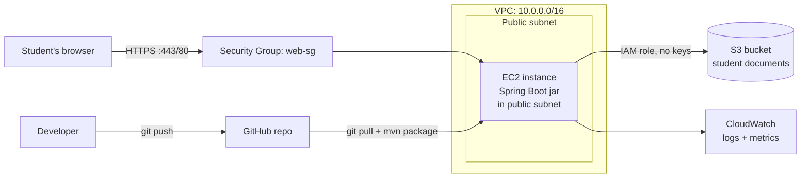

# Student Documents (Java / Spring Boot)

A small web app where students log in, upload coursework, and download it
back later. Built with **Java 17 and Spring Boot**; storage and
infrastructure run on AWS. This is a straight Java port of the same
project — same architecture, same AWS setup, no Python anywhere.

## Architecture



| Layer | Service / tech | Role in this project |
|---|---|---|
| App framework | **Spring Boot 3 (Java 17)** | Web server, security, templating |
| Compute | **EC2** | Hosts the app as a runnable `.jar`, kept alive by systemd |
| Storage | **S3** (via **AWS SDK for Java v2**) | Stores every student's uploaded files, one prefix per student |
| Access control | **IAM** | An instance role lets EC2 read/write only this S3 bucket — no access keys in code or config |
| Networking | **VPC** | Isolated network the EC2 instance lives in |
| Traffic control | **Security Groups** | Firewall rules: only HTTP/HTTPS and your own SSH IP get in |
| OS | **Linux (Ubuntu)** | Runs the jar as a systemd service under a non-root user |
| Monitoring | **CloudWatch** | CPU/memory/disk metrics and app logs |
| Source control | **Git/GitHub** | Code and docs live in a repo; EC2 pulls and rebuilds from it |
| User accounts | **Spring Security + H2** (file-based) | Login/registration, BCrypt-hashed passwords |
| Templating | **Thymeleaf** | Server-rendered HTML pages |

Students never talk to S3 directly — every upload and download goes through
the Spring app, which only ever lets a logged-in student read or write
objects under their own `students/<username>/` prefix in the bucket
(enforced in `S3Service.assertOwnership`).

---

## Project layout

```
studentdocs-java/
  pom.xml                                  Maven build
  src/main/java/com/studentdocs/
    StudentDocsApplication.java            entry point
    config/SecurityConfig.java             login, logout, route protection
    config/S3Config.java                   S3Client + S3Presigner beans
    model/User.java                        JPA entity
    repository/UserRepository.java
    service/AppUserDetailsService.java     Spring Security <-> User table
    service/S3Service.java                 all S3 calls (list/upload/download/delete)
    controller/AuthController.java         /login /register
    controller/DashboardController.java    /dashboard /upload /download /delete
    dto/DocumentView.java
  src/main/resources/
    application.properties
    templates/ (login.html, register.html, dashboard.html)
    static/css/style.css
  aws/            IAM + CloudWatch JSON, same as used in the setup below
  deploy/         setup_ec2.sh, studentdocs.service
```

## Prerequisites

- **Java 17** (`sudo apt install openjdk-17-jdk` on Ubuntu, or use
  [sdkman](https://sdkman.io) / your OS package manager)
- **Maven** (`sudo apt install maven`, or use the included `mvnw` if you
  generate one with `mvn -N wrapper:wrapper`)
- An AWS account with permission to create the resources below

You do **not** need Python or any Python tooling for this version.

## Running locally

```bash
export STUDENTDOCS_BUCKET=your-bucket-name   # needs real AWS credentials configured (aws configure)
export AWS_REGION=us-east-1
mvn spring-boot:run
# open http://localhost:8000
```

Local runs still talk to real S3 using whatever credentials
`~/.aws/credentials` has set up — there's no mock/local storage, so the code
path is identical in dev and production.

To build a runnable jar:

```bash
mvn -DskipTests package
java -jar target/studentdocs.jar
```

---

## 1. S3 — create the bucket

1. S3 console → **Create bucket**.
2. Name it something globally unique, e.g. `studentdocs-yourschool-2026`.
3. Region: pick the one closest to your students (this repo defaults to `us-east-1`).
4. **Block all public access** — leave this checked. Nobody downloads files
   directly from S3; the app hands out short-lived, per-user presigned URLs.
5. Enable **default encryption** (SSE-S3) and **versioning** (recommended).
6. Create the bucket.

## 2. IAM — give EC2 permission to use that bucket, nothing else

1. IAM console → **Roles** → **Create role** → trusted entity **AWS service
   → EC2**. (Matches `aws/iam-ec2-trust-policy.json` in this repo.)
2. Create a custom policy instead of using a managed one: IAM → **Policies**
   → **Create policy** → JSON tab → paste `aws/iam-s3-access-policy.json`,
   replacing `REPLACE_WITH_BUCKET_NAME` with your real bucket name in both
   places.
3. Name it `StudentDocsS3Access`, attach it to a role named
   `StudentDocsEC2Role`.
4. You'll attach this role to the EC2 instance in step 4 — that's what lets
   the AWS SDK in `S3Config.java` (via `DefaultCredentialsProvider`)
   authenticate with **no access keys anywhere in the app**.

## 3. VPC — networking

If you already have a default VPC, use it and skip to subnets. Otherwise:

1. VPC console → **Create VPC** → "VPC and more" → CIDR `10.0.0.0/16`.
2. This wizard also creates a public subnet, an internet gateway, and a
   route table pointing `0.0.0.0/0` at the internet gateway.
3. One public subnet is enough for a class project. For production, put
   the instance in a private subnet behind a load balancer — see
   "Hardening" below.

## 4. EC2 — launch the instance

1. EC2 console → **Launch instance**.
2. AMI: **Ubuntu Server 24.04 LTS**.
3. Instance type: `t3.small` recommended (the JVM + Maven build wants a
   bit more headroom than the `t3.micro` free-tier size; `t3.micro` will
   work but the first build may be slow).
4. Network: the VPC/public subnet from step 3, auto-assign public IP: on.
5. **IAM instance profile**: attach `StudentDocsEC2Role` from step 2.
6. Security group: create/select `web-sg` (step 5 below).
7. Key pair: create or reuse one for SSH access.
8. Launch, then note the instance's public IP or DNS name.

## 5. Security Groups — control traffic

| Type | Port | Source | Why |
|---|---|---|---|
| SSH | 22 | *your* IP only (`x.x.x.x/32`) | Admin access, never `0.0.0.0/0` |
| HTTP | 80 | `0.0.0.0/0` | Students reach the app |
| HTTPS | 443 | `0.0.0.0/0` | Once you add TLS |

Outbound: leave the default "allow all" — the instance needs it to reach
S3, CloudWatch, GitHub, and Maven Central. Port 8000 (where the jar
listens) is never opened to the internet directly — put nginx or an
Application Load Balancer in front for real deployments.

## 6. Linux — build and deploy the app on the instance

```bash
ssh -i your-key.pem ubuntu@<instance-public-ip>

# on the instance, as root:
sudo git clone <your-github-repo-url> /tmp/bootstrap
sudo bash /tmp/bootstrap/deploy/setup_ec2.sh
```

Before running it, edit `deploy/studentdocs.service` in your repo and
replace `REPLACE_WITH_BUCKET_NAME` with your real bucket name (commit that
change, or edit the deployed copy at
`/etc/systemd/system/studentdocs.service` directly).

`deploy/setup_ec2.sh`, running as root but installing everything under an
unprivileged `studentdocs` user, does the following:

- installs OpenJDK 17, Maven, git, and the CloudWatch agent
- clones this repo and runs `mvn package` to produce `studentdocs.jar`
- copies the jar to `/opt/studentdocs/studentdocs.jar`
- installs `deploy/studentdocs.service` as a systemd unit and starts it
- points the CloudWatch agent at `aws/cloudwatch-agent-config.json`

Useful commands once it's running:

```bash
sudo systemctl status studentdocs     # is it up?
sudo journalctl -u studentdocs -f     # live logs
sudo systemctl restart studentdocs    # after redeploying a new jar
```

## 7. CloudWatch — monitor the instance

The setup script installs and starts the CloudWatch agent using
`aws/cloudwatch-agent-config.json`, which ships:

- **Metrics**: CPU usage, memory used %, disk used % (EC2 doesn't report
  memory/disk by default — the agent adds them) under the
  `StudentDocs/EC2` namespace.
- **Logs**: `/var/log/studentdocs/app.log` (set via the
  `STUDENTDOCS_LOG_FILE` environment variable in the systemd unit) into
  log group `/studentdocs/app`, and syslog into `/studentdocs/syslog`.

In the CloudWatch console, set an alarm on `mem_used_percent` (the JVM
tends to be the memory-hungriest part of this stack) — e.g. > 85% —
notifying an SNS topic/email.

## 8. Git/GitHub — code and docs

```bash
git init
git add .
git commit -m "Initial commit: student documents app (Java)"
git remote add origin <your-github-repo-url>
git push -u origin main
```

Keep real bucket names/secrets out of the committed
`deploy/studentdocs.service` — the version here has a placeholder on
purpose. To ship an update: push to GitHub, then re-run
`deploy/setup_ec2.sh` on the instance (it rebuilds and restarts the
service), or build locally and `scp` a fresh `studentdocs.jar` to
`/opt/studentdocs/` followed by `sudo systemctl restart studentdocs`.

---

## Hardening ideas beyond this class-project baseline

- Put the EC2 instance in a **private subnet** behind an **Application
  Load Balancer**; only the ALB's security group accepts inbound
  80/443 from the internet.
- Terminate TLS at the ALB with an ACM certificate.
- Move from file-based H2 to **RDS**, or replace the login system with
  **Amazon Cognito** for real authentication (password resets, MFA).
- Add **S3 lifecycle rules** to archive old documents to Glacier.
- Use **AWS Systems Manager Session Manager** instead of SSH/port 22, and
  drop the SSH inbound rule entirely.
- Build the jar in **CI (GitHub Actions)** and have EC2 (or better, an
  Auto Scaling Group) just pull the built artifact, rather than building
  Maven on the instance itself.
